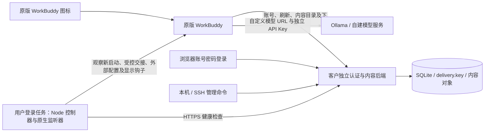

# 企业AI工作台：WorkBuddy 私有后端与外部启动器

开发版后端 **0.3.3**、客户端 **0.1.3** 新增[私有乐享接入](docs/lexiang-private-integration.md)：外置地址配置、既有账号认证复用、乐享链接定向和本地 Mock 验证。现有客户服务器和已发布的 0.3.2/0.1.2 交付包未在本次更新；客户真实乐享仍需按其版本联调。

当前推荐入口是 [客户端配置组件](client-distribution/README.md)：附带独立运行时，用户登录任务监听原版 WorkBuddy 的新启动，自动交接到带后端配置和企业名称的进程。用户仍点击原版 Dock 图标，不新增启动 `.app`；交接时可能出现短暂窗口切换。已发布客户端为 0.1.2，本次开发版为 0.1.3，均属于 macOS arm64 内部测试交付，尚未正式签名、公证。原有 `.command` 和旧 Dock 启动应用代码作为兼容及回退方案保留。

本项目让原版 WorkBuddy 使用自建账号与内容后端，并通过独立配置直连模型服务。后端支持本地账号密码、会话撤销、专家/技能/连接器目录和版本化安装包；macOS 启动入口显示“企业AI工作台”，支持 Dock 与用户登录时自动启动。实现不修改 `/Applications/WorkBuddy.app` 安装包。

仓库开发配置默认指向 `http://127.0.0.1:8787`。2026-10-17 在服务器部署客户独立后端 0.3.2，并将当时本机已安装客户端改为 `https://21.130.240.28:8443`，详细方案见 [客户交付](docs/customer-delivery.md)。该次部署保留原测试服务 `https://21.130.240.28`；本次乐享验证使用独立本地配置，不更新这两个远端实例。安装后的配置与登录态保存在当前用户的数据目录，不提交到 Git。

当前客户端组件验证 **WorkBuddy 5.8.3 / macOS Apple Silicon**，并按文件哈希匹配版本。旧版启动器另有 5.8.1 验证，认证 provider 有 5.8.0 协议回放；这些记录不能代替新版本验收。客户端升级后需要复验协议、启动参数和界面选择器。

## 架构与实现方式



`WORKBUDDY_DEV_ENDPOINT_OVERRIDE` 选择后端，`ACC_PRODUCT_CONFIG_PATH` 加载安装包外的产品配置。开关隐藏云端网盘、助理和 SkillHub 等未提供的入口，并调整私有内容来源。后端不返回模型定义，模型端点返回 501；任务应明确选择可用自定义模型。

两处企业名称通过外部启动脚本注册的运行时显示钩子实现：启动时临时启用随机 loopback Node Inspector，在原版入口执行前安装窗口加载钩子，恢复执行后关闭 Inspector 并确认端口关闭。钩子在原版进程内存中维护侧栏标题和首页标题，处理 React 重绘和界面刷新；安装钩子的辅助脚本随后退出，用户登录监听器继续运行。它不改变安装包字节，也不代理模型流量。

当前监听器校验新进程的路径、文件哈希、出生时间与归属，再交接到受控启动；不会在用户退出 WorkBuddy 时立即重新拉起。停用登录监听器后，原版图标恢复原行为。接管前仍可能存在短暂的原版启动阶段，不承诺该阶段绝无厂商请求；客户已有外网隔离时继续使用其网络策略，不安装额外防火墙或依赖 Clash。

## 目录

| 路径 | 内容 |
| --- | --- |
| [auth-gateway/](auth-gateway/README.md) | 真实认证、账号/会话管理、内容协议、包分发与测试 |
| [auth-gateway/deploy/](auth-gateway/deploy/README.md) | Linux systemd + Nginx 安装、升级、回滚、备份恢复 |
| [client-distribution/](client-distribution/README.md) | 当前客户端组件、原版图标监听、安装与停用 |
| [docs/customer-delivery.md](docs/customer-delivery.md) | 客户实例、交付清单、账号运维、备份与验收边界 |
| [docs/lexiang-private-integration.md](docs/lexiang-private-integration.md) | 私有乐享原理、客户端配置、身份 bridge 合同与验证结果 |
| [macos-launcher/](macos-launcher/README.md) | 历史 AppKit 启动应用，供兼容与回退 |
| `scripts/macos-launcher/` | 启动应用构建和当前用户安装脚本 |
| [ollama-local/](ollama-local/README.md) | 本机 Ollama 参数、缓存预热、量化对比与回退说明 |
| `scripts/ollama-local/` | 本机采集、复放、预热与配置恢复工具 |
| [workbuddy-launcher.json](workbuddy-launcher.json) | 网关、原版路径、显示名称与 Node 路径 |
| [auth-gateway/test/fixtures/](auth-gateway/test/fixtures/README.md) | 协议回放所需的有限客户端片段与来源哈希 |

## 私有乐享接入（后端 0.3.3 / 客户端 0.1.3）

入口保留在原版 WorkBuddy 的“更多 → 乐享知识库”，右侧继续使用原版知识库视图。客户端将公开地址写入安装包外的 `privateHost.lexiangHost/lexiangMCP`，网关复用现有账号密码登录、单会话限制和会话撤销。模型 URL 与 API Key 仍由自定义模型配置独立管理，不经乐享适配层。

| 代码 | 本次能力 |
| --- | --- |
| `auth-gateway/src/lexiang-config.mjs`、`client-profile.mjs` | 地址校验、产品配置生成及默认乐享链接转换 |
| `auth-gateway/src/lexiang-http.mjs` | 乐享连接状态、短期凭据、一次性预览登录、MCP 和 bridge 会话校验 |
| `auth-gateway/src/runtime-lexiang.mjs` | 复用短时 Inspector，定向乐享外部打开及现有/新建窗口导航，随后关闭调试端口 |
| `auth-gateway/src/lexiang-mock.mjs`、`auth-gateway/scripts/lexiang-mock.mjs` | 仅本机使用的账号隔离目录、搜索和文档预览 Mock |
| `client-distribution/` | 持久化 `lexiang` 设置，启动时重新生成产品配置，并将地址变更纳入进程所有权检查 |

### 客户端地址配置

在开发启动器的 `workbuddy-launcher.json`，或已安装组件的 `~/Library/Application Support/EnterpriseWorkbenchClient/state/workbuddy-launcher.json` 中，保留其他设置并合并：

```json
{
  "gateway": "https://auth.customer.example",
  "lexiang": {
    "enabled": true,
    "webOrigin": "https://knowledge.customer.example",
    "mcpOrigin": "https://knowledge-mcp.customer.example"
  }
}
```

地址必须是无路径、查询或账号信息的 origin；远程只允许 HTTPS，本机允许回环 HTTP。不要填写完整的 `/wb` 或 `/api/mcp` 路径，也不要在客户端填写 bridge 密钥或用户 Token。后台完整 MCP URL 单独配置。后续初始化和重启保留该对象；修改后完整退出 WorkBuddy，再从同一受控入口启动。不能手改每次启动都会重新生成的 `product.local.json`。

构建预置地址的客户端包时，在现有构建命令增加 `--lexiang-config client-distribution/lexiang.example.json`。恢复到关闭入口的配置可设 `"lexiang":{"enabled":false}` 后重新启动；不删除账号、知识库或模型文件。

### 本机 Mock

从仓库根目录运行，使用独立数据目录，保留原有账号库：

```sh
node auth-gateway/scripts/lexiang-mock.mjs --port 8791 --data-dir ./auth-gateway/data/lexiang-mock
```

将测试客户端的 `gateway`、`lexiang.webOrigin`、`lexiang.mcpOrigin` 都设为 `http://127.0.0.1:8791`。首次创建 `lexiang-demo`，随机密码只写入所选数据目录的 `initial-credentials.json`（0600），不打印。首次正常登录后，可打开知识库目录、点击文档预览，或在“添加文件 → 乐享知识库”输入“重启”并回车搜索。同一数据目录重启会保留账号、有效会话和文档；停止 Mock 使用 Ctrl+C。

Mock 使用现有真实账号密码认证，不是旧的免密码 Mock 登录按钮；仅允许回环服务地址和监听地址。它需要单独运行，不由客户端隐式创建或启动。生产后端归档排除 Mock 实现、测试账号和运行数据。

### 客户身份 bridge

服务端以 [lexiang.bridge.example.json](auth-gateway/examples/lexiang.bridge.example.json) 为模板，通过 `GATEWAY_LEXIANG_CONFIG_FILE` 指定配置；字段包括私有网页 origin、完整 `mcpUrl`、`bridgeOrigin`、权限 0600 的 `bridgeSecretFile` 和本地用户名到乐享成员 ID 的 `members` 映射。客户端仅持有公开地址与成员短期令牌，不接收 bridge 服务密钥。地址配置和 TLS 信任应在两端对应，不能关闭证书校验。

客户 bridge 需实现 `POST /session`（最长 300 秒的成员令牌）与 `POST /login-url`（受限登录 origin）。网关提供 `POST /private/lexiang/bridge/introspect`，供客户接入层检查绑定的 `subject/session_id` 是否仍有效。**客户必须执行该校验或等效撤销机制，才能让管理员释放会话同时约束其上游 Token/Cookie。** 这些是身份适配合同，不能假定所有乐享私有版原生具备相同接口。

残余公网链接通过限定域名的转换处理：清除旧凭据 query/fragment，并在跨 origin 加载时去除旧 POST、额外请求头和 referrer。该机制不改模型请求，也不提供整进程网络阻断。详细合同与 API 路径见[私有乐享说明](docs/lexiang-private-integration.md#客户服务端-bridge-配置)。

### 验证结果与范围

2026-10-19 本机验证使用原版 **WorkBuddy 5.8.3 / macOS Apple Silicon**、独立 profile 和本地 Mock；2026-10-20 提交前从 Git 暂存区导出的干净副本完整回归 **124/124 通过**，语法、JSON 和文档本地链接检查通过：

| 验证项 | 结果与证据范围 |
| --- | --- |
| 账号登录、目录与搜索 | 原版登录表单成功；原版知识库显示 Mock 团队及个人/团队文档；内容选择器检索“重启”返回对应文档 |
| 文档预览与外部打开 | 原版 webview 显示本地文档，“打开乐享”最终指向本地 `/spaces/...` |
| 完整退出与后端重启 | 同一外置入口重新启动，免登录恢复账号、品牌名称、目录及 `qwen3.8:27b` 模型选择 |
| 安全与稳定性 | 自动化覆盖账号/团队范围隔离、一次性票据、管理员释放、受限登录目标、140 次连续预览、bridge 成员映射和服务凭据隔离 |
| 安装包和模型 | ASAR、可执行文件、内置产品配置、核对的 renderer 文件以及复制的模型配置哈希未变；本次未重新运行模型推理性能测试 |
| 构建 | 后端 0.3.3 归档与客户端 0.1.3 PKG/ZIP 构建成功，客户端 21 个清单文件校验通过；未安装系统级 PKG、未正式签名公证 |

本次采用 `personal/native` 路径，没有伪造企业身份或商业许可；客户企业整页 iframe、真实 SSO/SPAPI/MCP、上传/导入、权限编辑和知识附件的模型工具调用仍待客户联调。未重启整台电脑，也未在本次更新远端部署。现场截图、日志、账号及构建物仅保存在被忽略的 `evidence/`、`dist/` 中；源码测试可使用临时目录独立运行。

## 开发工作区本地首次启动

以下用于开发和旧 `.command` 入口。新用户使用客户端 ZIP 安装，按 [客户交付说明](docs/customer-delivery.md#客户端安装) 配置，无需获得开发工作区。

需要 Node.js **24+**，后端仅使用 Node 内置模块，无需 `npm install`。macOS 客户端需另行安装原版 WorkBuddy；构建 Dock 应用还需要 Apple Swift 编译工具、`iconutil` 和 `codesign`。

在项目根目录执行：

```sh
cd auth-gateway
npm run user -- add tester --display-name 测试账号
npm start
```

终端会隐藏输入并确认密码，至少 15 个 Unicode 字符。没有默认账号或密码。创建账号初始化 `auth-gateway/data/` 中的数据库和 `delivery.key`，请保留两者。

编辑项目根目录 `workbuddy-launcher.json`：

```json
{
  "gateway": "http://127.0.0.1:8787",
  "appPath": "/Applications/WorkBuddy.app",
  "productName": "企业AI工作台",
  "welcomeTitle": "企业AI工作台，我帮你",
  "mode": "development",
  "nodeExecutable": "",
  "reuseDevelopmentAuth": false,
  "replaceProductionLogin": false,
  "caCertificate": ""
}
```

完整退出已有 WorkBuddy 后，双击 `启动WorkBuddy.command`，或在项目根目录运行：

```sh
./启动WorkBuddy.command --check
./启动WorkBuddy.command
```

在客户端点击登录，用刚创建的账号完成浏览器登录。随后在模型设置添加实际服务的模型 ID、URL 与 API Key，并在任务中选中它。示例结构见 [models.example.json](auth-gateway/examples/models.example.json)。模型凭证与登录凭证分开管理。

开发认证文件属于系统用户级共享存储，外部 profile 不会隔离它。遇到已有非本项目登录态时，启动器会保留文件并停止；只在确认可复用该测试登录态后设置 `reuseDevelopmentAuth:true`。`nodeExecutable` 留空会查找 Node 24+；nvm 等非默认安装位置可填写完整可执行路径。

`.command` 入口需要网关已运行。Dock 应用可以从**现有**账号库按需启动本地网关；缺少数据库或交付密钥时会拒绝创建空库。

## 历史 Dock 启动应用

本节是旧版兼容方案。当前客户交付使用原版 WorkBuddy 图标和客户端登录监听器，不执行本节安装步骤。

在项目根目录构建并安装：

```sh
node scripts/macos-launcher/build.mjs
node scripts/macos-launcher/install.mjs
```

安装到 `~/Applications/企业AI工作台.app`，将原 WorkBuddy 固定 Dock 图标替换为企业入口，并创建当前用户 LaunchAgent：

```text
~/Library/LaunchAgents/local.workbuddy.enterprise-ai-launcher.login.plist
```

登录任务使用 `RunAtLoad=true`、`KeepAlive=false`，通过 `/usr/bin/open -a` 调用同一应用。其他 Dock 项目保持原顺序；原图标条目备份留在本机 `evidence/dock-launcher/`。更新前需正常退出工作台和启动应用，安装器只覆盖带本项目管理标记的应用。

本机版本为 arm64、临时签名，未做发行公证或跨版本 macOS 验收。启动应用保存工作区位置，移动工作区后需重新构建安装。停用登录任务、恢复原版 Dock 图标和移除启动应用的方法见 [macos-launcher/README.md](macos-launcher/README.md)。

## 管理账号、会话和内容

在 `auth-gateway/` 执行：

```sh
npm run user -- list
npm run user -- set-password tester
npm run session -- list tester
npm run session -- revoke tester --all
npm run user -- disable tester
npm run audit -- --username tester --limit 100
```

密码重置、停用账号和撤销会话会使相关后端会话失效。客户端退出不一定调用服务端 logout；已安装的内容与独立模型 API Key 不会随会话撤销自动删除或吊销。

0.3.1 默认限制每个账号最多一个有效登录会话，所有电脑需使用同一个后端。已有会话时，新的密码登录返回 409 并提示管理员释放；原会话、刷新与重启恢复继续有效。用上面的 `session revoke` 命令释放后即可重新登录。关闭客户端和 access token 到期不会释放仍有效的 refresh 会话；未领取的登录凭证只占位到 state 的 5 分钟期限。

启动升级后的后端时，旧库若已有多会话，会保留最近使用的一条并撤销其余，记录审计；升级前请备份。具体有效期、选择规则和释放流程见 [单会话说明](auth-gateway/README.md#单账号单会话与管理员释放)。这项限制不提供设备绑定，也不会阻止断网后的本地模型调用。

可手动发布自有测试目录，联调展示、安装和更新：

```sh
npm run content:seed -- --version 1.1.0
npm run catalog -- list expert
npm run catalog -- list skill
npm run catalog -- list connector
```

正式内容通过 JSON manifest 与 `catalog publish` 发布。源文件必须位于 manifest 的相对目录内，后端生成不可变、SHA-256 定址的对象与安装包，发布不执行源码。详细布局、ACL 和更新规则见 [后端说明](auth-gateway/README.md#私有内容管理与包分发)。

专家/技能读取和受限下载复用登录会话。原版静态加载器及 legacy 连接器整包不携带 Bearer，只有显式 `metadata.public:true` 且无账号 ACL 的条目能进入匿名包；连接器整包需部署在符合内容可见范围的网络中。第三方连接器 OAuth 与业务服务需独立实现。

## 部署、配置和备份

客户独立实例与交付说明见 [客户交付](docs/customer-delivery.md)。部署器支持 `--instance customer`，隔离服务、账号、数据、管理命令与每日一致性备份；HTTPS 非默认端口保留完整 Host，不覆盖同机原测试实例。通用部署方法见后端部署 README。

2026-10-17 部署记录：

| 项目 | 客户实例 | 原测试实例 |
| --- | --- | --- |
| HTTPS | `https://21.130.240.28:8443` | `https://21.130.240.28` |
| 后端版本 | `0.3.2` | `0.3.0`，保留原配置与进程 |
| 服务名 | `workbuddy-auth-customer` | `workbuddy-auth` |
| 内部监听 | `127.0.0.1:8788` | `127.0.0.1:8787` |
| 程序目录 | `/opt/workbuddy-auth-customer` | `/opt/workbuddy-auth` |
| 配置 / 数据 | `/etc/workbuddy-auth-customer` / `/var/lib/workbuddy-auth-customer` | 原目录保持不变 |
| 定时备份 | `workbuddy-auth-customer-backup.timer` | 本次未调整 |

客户实例独立生成数据库、交付密钥和 TLS 私钥，复用现有私有 CA 签发证书。客户端仅分发公开 CA。备份每天服务器本地时间 03:15 加最多 10 分钟随机延迟执行，停机漏跑后补执行，输出到 `/var/lib/workbuddy-auth-customer-backups`；已执行并校验备份。当前为同机备份，保留全部版本，异机复制、保留期限与告警需交接运维。客户内容目录初始为空，通过该实例的管理命令发布内容。

```sh
sudo workbuddy-auth-customer health
sudo workbuddy-auth-customer session list customer-demo
sudo workbuddy-auth-customer session revoke customer-demo --all
sudo systemctl list-timers workbuddy-auth-customer-backup.timer
```

客户交付包含客户端 ZIP、后端发布包、公开 CA 与指纹、安装运维说明、验收记录和 SHA-256 清单；密码通过独立安全渠道交付。原版 WorkBuddy 安装包、模型运行时与权重需另行准备。当前本机生成物位于 `dist/customer-21.130.240.28-0.3.2/`，汇总包为 `dist/WorkBuddy客户交付-0.3.2-21.130.240.28.zip`。这些生成物不进入 Git，源码和重建方法随本次提交保存。

本地默认仅监听 loopback。远程入口要求可信 HTTPS；配置示例见 [auth-gateway/.env.example](auth-gateway/.env.example)。程序不会自动读取 `.env`，使用文件配置时执行：

```sh
node --env-file=.env src/main.mjs
```

在 `auth-gateway/` 构建发布包：

```sh
npm test
npm run package
```

发布包只包含正式后端、管理命令、部署脚本和独立后端测试。Linux 部署需预装 Node 24+、systemd、Nginx 并准备 TLS 证书；安装、render-only 预览、升级、回滚与数据恢复见 [部署说明](auth-gateway/deploy/README.md)。私有 CA 应通过 `caCertificate` 和系统信任配置接入，客户端仅接收公开 CA；不关闭 TLS 校验。

SQLite 后端限单机单进程，数据目录有独占锁。使用 `npm run backup` 保存数据库、`delivery.key` 和内容对象，恢复会让旧会话失效；不要只复制数据库。代码回滚保留数据，数据恢复需停服务并保留恢复前副本。

## Ollama 工具与本机试验边界

本机完成了原 Q8 模型的 64K 上下文、512 输入批次、F16 KV、单槽和 30 分钟驻留配置，并测试了独立 Q4_K_M 副本。默认保留 Q8。稳定前缀预热在约 31K 输入的两个顺序原版任务中使输入处理约为 47 秒；首次冷预热仍耗时约 344 秒，串行生成与排队仍存在。完整条件和量化质量限制见 [Ollama 记录](ollama-local/README.md)。

这些工具依赖本机的原模型备份、模型 digest、环境快照及完整请求捕获。模型权重、`evidence/ollama-local/` 和私有请求**不进入 Git**；新检出不能直接运行“应用/回退 Ollama 优化”或预热脚本，必须先在目标机器重新建立基线与匹配前缀。它们不是通用一键模型安装器。日常 Dock 入口也不自动执行 Ollama 预热。

## 验证与提交范围

开发工作区完整测试：

```sh
cd auth-gateway
npm test
```

测试覆盖账号密码、CSRF、限流、刷新旋转与并行重试、会话撤销、持久化、备份恢复、内容发布/下载、部署包、外部配置和启动生命周期，以及原版消费者回放。夹具随源码提交，不依赖被忽略的本机 `evidence/`；测试在临时目录使用独立数据库，不操作当前账号库或启动真实 WorkBuddy。

2026-10-14 入库核验：从 Git 暂存文件导出的干净副本运行 **76 项测试全部通过，无跳过项**，原生启动应用重新构建并通过临时签名校验。另通过 JavaScript/启动脚本语法、夹具哈希与文档链接检查；本次未重新执行真实桌面业务验收。

2026-10-14 单会话版本 0.3.1 核验：**83 项测试通过，无跳过项**，新增同时网页登录、独立 SQLite 连接竞争、后端重启、管理员释放、过期占位和旧库多会话处理测试。本机原版 WorkBuddy 5.8.1 已验证：独立网页登录被拒绝；管理员释放后，客户端重启回到登录页并可重新登录；随后完整退出再启动，自动恢复同一会话，账号库仍只有一个有效会话。安装包 ASAR、可执行文件、内置产品配置和自定义模型文件前后哈希一致。现场截图与记录留在本机 `evidence/single-session/`，不提交私有数据；本轮没有使用两台实体电脑或再次调用模型。

此前本机用原版 5.8.1 验证了真实登录、重启恢复、撤销后的失效提示、私有目录展示/安装/更新、云入口屏蔽、品牌重启/刷新，以及 Dock 登录任务完整冷启动与重复激活。验收前后原安装包与模型配置哈希保持一致。**未实际重启电脑**，已验证的是启用后的登录任务及冷启动路径；其他客户端版本、所有系统恢复路径和完整业务模型质量仍需现场验收。

客户端配置交付 0.1.0：完整测试 93 项通过。本机原版 5.8.3 已验证浏览器首次地址设置、现有 profile 迁移、旧启动入口归档、用户级组件停用/恢复/重装，以及移开解压源目录后通过直接调用脚本的登录任务冷启动。原版 Dock 固定入口为 1 个、旧启动应用入口为 0 个，其他固定项目顺序保持；原版 ASAR、可执行文件、内置产品配置和模型定义文件哈希一致。临时设置服务已关闭，辅助脚本退出，账号仍只有一个有效会话。产物位于 dist/WorkBuddy-client-0.1.0/，未包含账号库、凭据、原版程序或模型权重。系统级 PKG、干净新机和真实电脑重启尚未验收；测试包未正式签名公证，完整退出后点击原版图标绕过脚本的边界仍在。

客户端配置交付 0.1.1 已替代上面的原版图标绕过限制：用户登录任务常驻监听原版新进程，校验出生身份、版本和是否已有主窗口，再自动交接到带认证及名称配置的原版实例；只接管 8 秒内的新启动，不新增 `.app`，不改安装包、全局环境或模型路径。已有主窗口用应用退出请求，尚无主窗口用 SIGTERM，不追加 SIGKILL；退出应用本身不会触发拉起。Finder 原版图标连续三轮退出重启通过，交接 1.44–1.47 秒，两处企业名称、登录状态及自定义模型选择保留，后端账号与刷新各 3 次 HTTP 200，有效会话仍为 1，原包及模型配置哈希不变。完整回归 103/103。最终本地测试包在 dist/WorkBuddy-client-0.1.1/。真实电脑重启、干净新机、系统级 PKG、正式签名公证及未实现的云功能仍不包含在此验收内，详见客户端配置 README。

客户端 0.1.2 / 私有后端 0.3.2：取消额外防火墙依赖，修复中文技能查询 400、元数据通知高频重复传递和同实例 sidecar 误判；关闭的云助理只读目录返回有认证的空列表。网络立即失败及延迟失败条件下，原版 5.8.3 已完成冷启动、登录/历史恢复，并两次实际直连本地 qwen3.8:27b，分别约 7m12s、40s。技能查询观察值由约 63 次/秒降至约 1.85 次/秒。这里采用进程内故障注入，不代表物理断网或客户隔离网验收；长输入仍是模型耗时主要部分。完整回归 112/112。完整说明和现场验收步骤见 [无外网验收](docs/offline-validation.md)。0.1.2 测试包在 dist/WorkBuddy-client-0.1.2/，不含验收注入脚本。

2026-10-17 客户独立实例：工作区完整测试 **114/114**，目标 Linux 发布包测试 **37/37**。真实 HTTPS 验证登录、已有会话时返回 409、客户服务重启后的账号查询与刷新、管理员释放后旧 access/refresh 返回 401、释放后重新登录，以及客户凭证不能访问测试实例。原版 5.8.3 完成首次客户账号登录和完整退出后原入口重开，两处企业名称、账号及 qwen3.8:27b 选择恢复，有效会话保持 1；临时 Inspector 已关闭，安装包与模型配置哈希未变。原版客户端直接连接本机 Ollama 并收到完整回复，界面耗时 7m13s，30,580 token 输入处理约 364.8 秒。这不是认证耗时或客户硬件容量承诺。

本次仍未验证系统级 PKG 安装、干净新机、整机重启或客户真实隔离网。客户端未正式签名公证，部分未实现云接口仍返回 404；这些边界与单机 SQLite、模型独立授权的限制见 [客户交付说明](docs/customer-delivery.md#验收边界)。

本仓库保存自有源码、方案文档、启动配置默认值和有限协议夹具。`.gitignore` 排除账号库、交付密钥、证书、测试凭据、profile、备份、日志、完整逆向产物、私有对话、模型权重和生成的应用/发布包。它们继续留在当前机器，不因提交被删除。验收记录中提到的 `evidence/` 是本机取证路径，干净检出不会包含这些现场材料。
