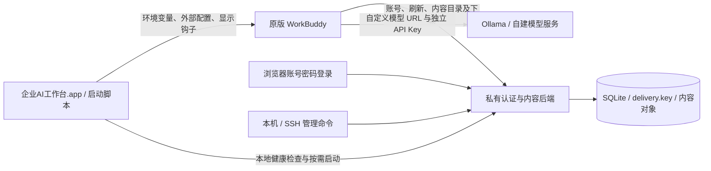

# 企业AI工作台：WorkBuddy 私有后端与外部启动器

新增客户端配置交付入口见 [client-distribution/README.md](client-distribution/README.md)：附带独立运行时、首次地址设置、原版 Dock 图标和直接运行脚本的登录任务，不新增启动 `.app`。当前交付为可配置地址的 macOS arm64 内部测试包，尚未正式签名公证；完整退出后从原版图标冷启动的绕过边界仍保留。原有 `.command` 和旧 Dock 启动应用代码作为兼容及回退方案保留。

本项目让原版 WorkBuddy 使用自建账号与内容后端，并通过独立配置直连模型服务。后端支持本地账号密码、会话撤销、专家/技能/连接器目录和版本化安装包；macOS 启动入口显示“企业AI工作台”，支持 Dock 与用户登录时自动启动。实现不修改 `/Applications/WorkBuddy.app` 安装包。

当前配置指向本机 `http://127.0.0.1:8787`。旧版启动器按 WorkBuddy **5.8.1 / macOS Apple Silicon** 验证；新客户端配置组件已补充 **5.8.3** 的本机验证并按文件哈希匹配版本。认证 provider 另有 5.8.0 协议回放。客户端升级后需要复验协议、启动参数和界面选择器。

## 架构与实现方式



`WORKBUDDY_DEV_ENDPOINT_OVERRIDE` 选择后端，`ACC_PRODUCT_CONFIG_PATH` 加载安装包外的产品配置。开关隐藏云端网盘、助理和 SkillHub 等未提供的入口，并调整私有内容来源。后端不返回模型定义，模型端点返回 501；任务应明确选择可用自定义模型。

两处企业名称通过外部启动器注册的运行时显示钩子实现：启动时临时启用随机 loopback Node Inspector，在原版入口执行前安装窗口加载钩子，恢复执行后关闭 Inspector 并确认端口关闭。钩子在原版进程内存中维护侧栏标题和首页标题，处理 React 重绘和界面刷新；启动辅助程序随后退出。它不改变安装包字节，也不代理模型流量。

Dock 应用在工作台运行期间保留一个用于激活窗口的原生入口，工作台退出时一并退出。原版应用直接启动、macOS 恢复上次窗口或原版自更新重启可能绕过此入口；名称持续生效以通过本项目入口启动为前提。

## 目录

| 路径 | 内容 |
| --- | --- |
| [auth-gateway/](auth-gateway/README.md) | 真实认证、账号/会话管理、内容协议、包分发与测试 |
| [auth-gateway/deploy/](auth-gateway/deploy/README.md) | Linux systemd + Nginx 安装、升级、回滚、备份恢复 |
| [macos-launcher/](macos-launcher/README.md) | AppKit 启动应用、图标、Dock 与登录任务 |
| `scripts/macos-launcher/` | 启动应用构建和当前用户安装脚本 |
| [ollama-local/](ollama-local/README.md) | 本机 Ollama 参数、缓存预热、量化对比与回退说明 |
| `scripts/ollama-local/` | 本机采集、复放、预热与配置恢复工具 |
| [workbuddy-launcher.json](workbuddy-launcher.json) | 网关、原版路径、显示名称与 Node 路径 |
| [auth-gateway/test/fixtures/](auth-gateway/test/fixtures/README.md) | 协议回放所需的有限客户端片段与来源哈希 |

## 本地首次启动

需要 Node.js **24+**，后端仅使用 Node 内置模块，无需 `npm install`。macOS 客户端需另行安装原版 WorkBuddy；构建 Dock 应用还需要 Apple Swift 编译工具、`iconutil` 和 `codesign`。

在项目根目录执行：

```sh
cd auth-gateway
npm run user -- add tester --display-name 测试账号
npm start
```

终端会隐藏输入并确认密码，至少 15 个 Unicode 字符。没有默认账号或密码。创建账号初始化 `auth-gateway/data/` 中的数据库和 `delivery.key`，请保留两者。

编辑项目根目录 `workbuddy-launcher.json`：

```json
{
  "gateway": "http://127.0.0.1:8787",
  "appPath": "/Applications/WorkBuddy.app",
  "productName": "企业AI工作台",
  "welcomeTitle": "企业AI工作台，我帮你",
  "mode": "development",
  "nodeExecutable": "",
  "reuseDevelopmentAuth": false,
  "replaceProductionLogin": false,
  "caCertificate": ""
}
```

完整退出已有 WorkBuddy 后，双击 `启动WorkBuddy.command`，或在项目根目录运行：

```sh
./启动WorkBuddy.command --check
./启动WorkBuddy.command
```

在客户端点击登录，用刚创建的账号完成浏览器登录。随后在模型设置添加实际服务的模型 ID、URL 与 API Key，并在任务中选中它。示例结构见 [models.example.json](auth-gateway/examples/models.example.json)。模型凭证与登录凭证分开管理。

开发认证文件属于系统用户级共享存储，外部 profile 不会隔离它。遇到已有非本项目登录态时，启动器会保留文件并停止；只在确认可复用该测试登录态后设置 `reuseDevelopmentAuth:true`。`nodeExecutable` 留空会查找 Node 24+；nvm 等非默认安装位置可填写完整可执行路径。

`.command` 入口需要网关已运行。Dock 应用可以从**现有**账号库按需启动本地网关；缺少数据库或交付密钥时会拒绝创建空库。

## Dock 与用户登录启动

在项目根目录构建并安装：

```sh
node scripts/macos-launcher/build.mjs
node scripts/macos-launcher/install.mjs
```

安装到 `~/Applications/企业AI工作台.app`，将原 WorkBuddy 固定 Dock 图标替换为企业入口，并创建当前用户 LaunchAgent：

```text
~/Library/LaunchAgents/local.workbuddy.enterprise-ai-launcher.login.plist
```

登录任务使用 `RunAtLoad=true`、`KeepAlive=false`，通过 `/usr/bin/open -a` 调用同一应用。其他 Dock 项目保持原顺序；原图标条目备份留在本机 `evidence/dock-launcher/`。更新前需正常退出工作台和启动应用，安装器只覆盖带本项目管理标记的应用。

本机版本为 arm64、临时签名，未做发行公证或跨版本 macOS 验收。启动应用保存工作区位置，移动工作区后需重新构建安装。停用登录任务、恢复原版 Dock 图标和移除启动应用的方法见 [macos-launcher/README.md](macos-launcher/README.md)。

## 管理账号、会话和内容

在 `auth-gateway/` 执行：

```sh
npm run user -- list
npm run user -- set-password tester
npm run session -- list tester
npm run session -- revoke tester --all
npm run user -- disable tester
npm run audit -- --username tester --limit 100
```

密码重置、停用账号和撤销会话会使相关后端会话失效。客户端退出不一定调用服务端 logout；已安装的内容与独立模型 API Key 不会随会话撤销自动删除或吊销。

0.3.1 默认限制每个账号最多一个有效登录会话，所有电脑需使用同一个后端。已有会话时，新的密码登录返回 409 并提示管理员释放；原会话、刷新与重启恢复继续有效。用上面的 `session revoke` 命令释放后即可重新登录。关闭客户端和 access token 到期不会释放仍有效的 refresh 会话；未领取的登录凭证只占位到 state 的 5 分钟期限。

启动升级后的后端时，旧库若已有多会话，会保留最近使用的一条并撤销其余，记录审计；升级前请备份。具体有效期、选择规则和释放流程见 [单会话说明](auth-gateway/README.md#单账号单会话与管理员释放)。这项限制不提供设备绑定，也不会阻止断网后的本地模型调用。

可手动发布自有测试目录，联调展示、安装和更新：

```sh
npm run content:seed -- --version 1.1.0
npm run catalog -- list expert
npm run catalog -- list skill
npm run catalog -- list connector
```

正式内容通过 JSON manifest 与 `catalog publish` 发布。源文件必须位于 manifest 的相对目录内，后端生成不可变、SHA-256 定址的对象与安装包，发布不执行源码。详细布局、ACL 和更新规则见 [后端说明](auth-gateway/README.md#私有内容管理与包分发)。

专家/技能读取和受限下载复用登录会话。原版静态加载器及 legacy 连接器整包不携带 Bearer，只有显式 `metadata.public:true` 且无账号 ACL 的条目能进入匿名包；连接器整包需部署在符合内容可见范围的网络中。第三方连接器 OAuth 与业务服务需独立实现。

## 部署、配置和备份

本地默认仅监听 loopback。远程入口要求可信 HTTPS；配置示例见 [auth-gateway/.env.example](auth-gateway/.env.example)。程序不会自动读取 `.env`，使用文件配置时执行：

```sh
node --env-file=.env src/main.mjs
```

在 `auth-gateway/` 构建发布包：

```sh
npm test
npm run package
```

发布包只包含正式后端、管理命令、部署脚本和独立后端测试。Linux 部署需预装 Node 24+、systemd、Nginx 并准备 TLS 证书；安装、render-only 预览、升级、回滚与数据恢复见 [部署说明](auth-gateway/deploy/README.md)。私有 CA 应通过 `caCertificate` 和系统信任配置接入，客户端仅接收公开 CA；不关闭 TLS 校验。

SQLite 后端限单机单进程，数据目录有独占锁。使用 `npm run backup` 保存数据库、`delivery.key` 和内容对象，恢复会让旧会话失效；不要只复制数据库。代码回滚保留数据，数据恢复需停服务并保留恢复前副本。

## Ollama 工具与本机试验边界

本机完成了原 Q8 模型的 64K 上下文、512 输入批次、F16 KV、单槽和 30 分钟驻留配置，并测试了独立 Q4_K_M 副本。默认保留 Q8。稳定前缀预热在约 31K 输入的两个顺序原版任务中使输入处理约为 47 秒；首次冷预热仍耗时约 344 秒，串行生成与排队仍存在。完整条件和量化质量限制见 [Ollama 记录](ollama-local/README.md)。

这些工具依赖本机的原模型备份、模型 digest、环境快照及完整请求捕获。模型权重、`evidence/ollama-local/` 和私有请求**不进入 Git**；新检出不能直接运行“应用/回退 Ollama 优化”或预热脚本，必须先在目标机器重新建立基线与匹配前缀。它们不是通用一键模型安装器。日常 Dock 入口也不自动执行 Ollama 预热。

## 验证与提交范围

开发工作区完整测试：

```sh
cd auth-gateway
npm test
```

测试覆盖账号密码、CSRF、限流、刷新旋转与并行重试、会话撤销、持久化、备份恢复、内容发布/下载、部署包、外部配置和启动生命周期，以及原版消费者回放。夹具随源码提交，不依赖被忽略的本机 `evidence/`；测试在临时目录使用独立数据库，不操作当前账号库或启动真实 WorkBuddy。

2026-10-14 入库核验：从 Git 暂存文件导出的干净副本运行 **76 项测试全部通过，无跳过项**，原生启动应用重新构建并通过临时签名校验。另通过 JavaScript/启动脚本语法、夹具哈希与文档链接检查；本次未重新执行真实桌面业务验收。

2026-10-14 单会话版本 0.3.1 核验：**83 项测试通过，无跳过项**，新增同时网页登录、独立 SQLite 连接竞争、后端重启、管理员释放、过期占位和旧库多会话处理测试。本机原版 WorkBuddy 5.8.1 已验证：独立网页登录被拒绝；管理员释放后，客户端重启回到登录页并可重新登录；随后完整退出再启动，自动恢复同一会话，账号库仍只有一个有效会话。安装包 ASAR、可执行文件、内置产品配置和自定义模型文件前后哈希一致。现场截图与记录留在本机 `evidence/single-session/`，不提交私有数据；本轮没有使用两台实体电脑或再次调用模型。

此前本机用原版 5.8.1 验证了真实登录、重启恢复、撤销后的失效提示、私有目录展示/安装/更新、云入口屏蔽、品牌重启/刷新，以及 Dock 登录任务完整冷启动与重复激活。验收前后原安装包与模型配置哈希保持一致。**未实际重启电脑**，已验证的是启用后的登录任务及冷启动路径；其他客户端版本、所有系统恢复路径和完整业务模型质量仍需现场验收。

客户端配置交付 0.1.0：完整测试 93 项通过。本机原版 5.8.3 已验证浏览器首次地址设置、现有 profile 迁移、旧启动入口归档、用户级组件停用/恢复/重装，以及移开解压源目录后通过直接调用脚本的登录任务冷启动。原版 Dock 固定入口为 1 个、旧启动应用入口为 0 个，其他固定项目顺序保持；原版 ASAR、可执行文件、内置产品配置和模型定义文件哈希一致。临时设置服务已关闭，辅助脚本退出，账号仍只有一个有效会话。产物位于 dist/WorkBuddy-client-0.1.0/，未包含账号库、凭据、原版程序或模型权重。系统级 PKG、干净新机和真实电脑重启尚未验收；测试包未正式签名公证，完整退出后点击原版图标绕过脚本的边界仍在。

本仓库保存自有源码、方案文档、启动配置默认值和有限协议夹具。`.gitignore` 排除账号库、交付密钥、证书、测试凭据、profile、备份、日志、完整逆向产物、私有对话、模型权重和生成的应用/发布包。它们继续留在当前机器，不因提交被删除。验收记录中提到的 `evidence/` 是本机取证路径，干净检出不会包含这些现场材料。
