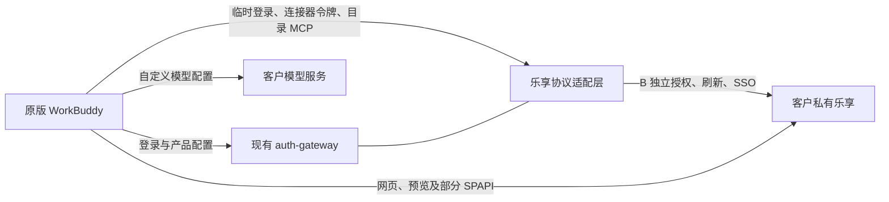

# WorkBuddy 接入客户私有化腾讯乐享：调查结论

首次调查：2026-10-19；双账号更新：2026-10-23。当前后端 0.4.0、客户端 0.1.3。WorkBuddy 使用主账号 A，乐享使用独立账号 B，必须单独登录并确认绑定；安装包保留原样，模型仍直连。本次完成本地 Mock 和原版 5.9.1 验证，没有部署客户远端实例。

## 结论

WorkBuddy 5.8.3 与本次核对的 5.9.1 包含乐享私有域名配置：`privateHost.lexiangHost` 与 `privateHost.lexiangMCP`。可以沿用现有外置产品配置机制下发，不需要改安装包。

内置乐享同时涉及网页、临时登录、连接器授权、MCP 查询和 SPAPI；部分原生页面链接仍固定生成公网域名。当前已在 auth-gateway 中补充 Mock 和可配置 bridge 适配，并通过运行时钩子定向残余链接。客户实际乐享的版本、接口和身份体系尚未提供，故真实系统兼容仍待联调。

## 已确认的地址配置

以下为启动组件实际生成的 **WorkBuddy 产品配置片段**；管理员应填写后文的客户端 `lexiang` 配置，不直接编辑每次启动都会重新生成的产品文件。域名仅为示例：

```json
{
  "privateHost": {
    "lexiangHost": "https://knowledge.customer.example",
    "lexiangMCP": "https://knowledge-mcp.customer.example"
  },
  "productFeatures": {
    "TencentLexiangKnowledge": true
  }
}
```

| 字段/机制 | 已确认用途 | 限制 |
| --- | --- | --- |
| `privateHost.lexiangHost` | 内嵌知识库 `/wb`、空间 `/wb/spaces/...` 的 origin；主进程 SPAPI、许可检查的 origin；部分 URL 和 Cookie 域名判断 | 原生页面的部分链接不读此字段；许可检查是否触发受产品及身份分支影响 |
| `privateHost.lexiangMCP` | 生成乐享连接器的企业专有环境变体 | 在该变体构建分支中自动拼接 `/api/mcp?preset=meta`，不是任意完整 MCP 路径配置；是否选中变体取决于账号身份和连接器定义 |
| `TencentLexiangKnowledge` | 乐享功能入口开关 | 开启入口不代表完成授权 |
| `WORKBUDDY_DEV_ENDPOINT_OVERRIDE` | WorkBuddy 主后端及其相对协议请求 | 单独设置此变量不能覆盖所有乐享地址 |

地址解析使用 `new URL(...).origin`，会去掉路径前缀。例如 `https://host/lexiang` 会变成 `https://host`，所以应提供独立域名或在该 origin 的根路径正确承载接口；不能直接把一个带子目录的地址当作已兼容入口。

## 为什么还需要后端适配



当前客户端中可确认的协议包括：

| 协议 | 用途 | 实现要求 |
| --- | --- | --- |
| `POST /v2/as/connector/oauth/{name}/temp-login-url` | 原生模式的乐享临时登录 | 根据当前用户换取客户乐享认可的登录链接；返回 `code:0,data.login_url` |
| `POST /console/enterprises/{enterpriseId}/lexiang/temp-login-url` | 企业内嵌模式临时登录 | 该分支先要求企业 ID，随后请求登录链接 |
| `GET /v2/as/connector/oauth/{name}/accesstoken` | 乐享专用访问令牌 | 返回客户端可用于目标乐享服务的令牌，不能直接沿用私有网关会话 token |
| `POST /console/agent-gateway/lexiang-ol/mcp` | 原生目录、搜索等 MCP 工具请求 | 接收 `tools/call → call_rpc → tool_name`，转发或转换为客户版实际 API |
| `/console/agent-gateway/lexiang-ol/api/...` | `exclusive`/`premise` 账号的网关分支 | 仅在对应实际账号类型下出现，不应为切换 UI 而伪造账号类型 |
| 私有乐享 origin 下的 `/spapi/...` | 部分内容及上传相关操作 | 确认客户版本具备相同接口及授权要求 |
| `/tapi/account/v1/check-license`、`/tapi/account/v1/check-company-status` | 许可/企业状态查询 | 仅在被选中的功能分支中接入客户真实状态，不能伪造授权成功 |

`name` 的常量标识为 `lexiang-ol`，访问令牌请求还经过 `connectorService.resolveOauthName()`；实际部署应按连接器映射确认名称。

原生模式调用目录 MCP 时，地址取 WorkBuddy 主 endpoint，即现有私有网关。只配置 `lexiangMCP` 不会把这条原生目录查询直接迁移到客户 MCP。

网页模式也有条件：`useLexiangLibraryMode()` 仅在企业版本且乐享 OneID 应用状态为 `enabled` 时返回 `iframe`，其余为 `native`。当前网关返回的是 `personal` 账号，不含企业 ID，因此不能仅靠填写域名就假定进入企业内嵌模式。必须保留真实身份语义，使用用户明确同意的 A 到 B 绑定，不以配置映射替代独立登录。

官方分别提供 [SSO 接入文档](https://lexiangla.com/wiki/api/32001.html) 和 [知识库开放接口文档](https://lexiang.tencent.com/wiki/api/)。网页 SSO 登录与后端 API 凭证需要分别确认；这些公开文档不能证明客户某个私有版具备 WorkBuddy 使用的内部接口。

## 已实现的接入点

实现集中在安装包之外：

1. 客户端 `lexiang.webOrigin/mcpOrigin` 持久化到用户设置，每次生成外置 `product.local.json` 时写入 `privateHost`。配置变更纳入启动所有权判断，不能把旧地址的既有进程误判为已应用新配置。
2. auth-gateway 增加独立授权状态、B 登录及明确同意、解除绑定、短期令牌、一次性预览与 MCP 适配。绑定持久化到 SQLite，B 刷新令牌用现有 `delivery.key` 经 AES-GCM 加密，Mock 密码使用 scrypt，短期访问/预览凭据只保存哈希。访问同时校验 A 会话、B 有效性和 binding 代次；管理员释放 A 后旧会话访问被拒绝，但不把持久 B 绑定视作新 A 会话的凭据。客户端成员访问令牌最长 5 分钟，不超过 A 和 B 的有效期。
3. `/v3/config` 返回公开的私有地址和功能开关，但继续保持 `config.disabled:true` 与空默认模型列表。当前以外置客户端配置为持久入口，不依赖远程配置轮询。后台与客户端地址必须由管理员对应配置。
4. 临时登录接口将旧公网目标转换并校验为客户 origin。现有短时 Inspector 在原版入口执行前安装内存钩子，定向 `shell.openExternal`、现有及新建 webContents 的乐享导航。只匹配明确的乐享域名边界，清除旧 Token、OAuth query、fragment，以及跨 origin 加载时的 POST、额外请求头和 referrer，随后关闭 Inspector。它不拦截模型 API，不是网络防火墙。
5. 本地 Mock 使用两个独立账号库：A 复用既有单会话认证，B 自有密码与成员 ID，内容按 B 隔离；只监听回环地址。B 登录不创建 WorkBuddy 会话；A 登录不自动授权 B。生产归档不包含 Mock 或账号库。

## 客户端配置

在用户 `state/workbuddy-launcher.json` 或开发启动器配置中增加下面的对象，保留原有 `gateway` 等字段：

```json
{
  "lexiang": {
    "enabled": true,
    "webOrigin": "https://knowledge.customer.example",
    "mcpOrigin": "https://knowledge-mcp.customer.example"
  }
}
```

本地测试将两个地址都设为 `http://127.0.0.1:8791`；关闭入口使用 `"lexiang":{"enabled":false}`。地址必须是无路径、查询、用户信息的 origin，远程只允许 HTTPS。客户端配置不接受账号、Token、SSO 密钥等额外字段。打包可传 `--lexiang-config client-distribution/lexiang.example.json`，把公开地址预置到客户端交付包。

## 本地 Mock 启动

在仓库根目录运行（Node 24+）：

```sh
node auth-gateway/scripts/lexiang-mock.mjs --port 8791 --data-dir ./auth-gateway/data/lexiang-mock
```

首次创建 WorkBuddy 账号 `lexiang-demo` 和独立乐享账号 `knowledge-demo`。随机密码分别写入指定数据目录的 `initial-credentials.json`、`lexiang-credentials.json`，权限 0600，不打印。两个密码分别管理。保留数据目录与 `delivery.key` 可复用有效会话、授权绑定和知识库；脚本只随源码提供，不在生产归档内。

客户端 `gateway` 同时指向 `http://127.0.0.1:8791`，`lexiang.webOrigin/mcpOrigin` 使用相同地址。用 A 登录后，打开“更多 → 乐享知识库”，点击授权，用 B 登录，再确认绑定。可从“添加文件 → 乐享知识库”进入内容选择器，输入关键词并按回车搜索；点击右侧文档可验证预览。完整退出 WorkBuddy 后按同一受控入口启动，应免登录恢复。切换认证域前保管旧开发登录态；不同环境使用独立 profile 和账号库，不覆盖正式账号。

## 客户服务端 bridge 配置

以 `auth-gateway/examples/lexiang.bridge.example.json` 为模板，通过 `GATEWAY_LEXIANG_CONFIG_FILE` 加载。必填 `webOrigin`、完整 `mcpUrl`、`bridgeOrigin`、`bridgeSecretFile`；`authorizationOrigins` 默认为 bridge origin，`loginOrigins` 默认为网页 origin。域名使用 HTTPS，内网 CA 正常加入信任，不关闭 TLS 校验。服务密钥为至少 32 字符的无空白字符串，存入权限 0600 的普通文件，不能发给客户端。

可选 `members: {"workbuddy用户名":"允许的B成员ID"}` 仅限制该 A 可绑定的成员；不填时由实际授权结果决定。该字段不会创建 B 授权，也不能让 A 密码冒充 B 登录。

以下是**需要客户实现的身份适配合同**，不能视为所有乐享私有版原生具备这些 API。请求均为 JSON，并由网关的服务 Bearer 认证；允许直接返回对象或 `code:0,data:{...}`：

| 接口 | 请求与返回 |
| --- | --- |
| `POST {bridgeOrigin}/authorize` | 请求 `{state,redirect_uri,session_id,code_challenge,code_challenge_method:"S256",expires_at}`；返回 `{authorize_url}`，origin 必须在 `authorizationOrigins`。客户页完成 B 独立登录和授权后以一次性 `code,state` 回调网关 |
| `POST {bridgeOrigin}/exchange` | 请求 `{code,state,redirect_uri,code_verifier,binding_id,session_id}`；验证一次性授权码与 PKCE，返回 `{subject,display_name?,refresh_token,refresh_expires_at}` |
| `POST {bridgeOrigin}/refresh` | 请求 `{subject,binding_id,session_id,refresh_token}`；返回上项 grant 加 `{access_token,expires_at}`。应轮换 B 刷新令牌，旧刷新令牌不可重用；访问令牌最长 300 秒且不超过 A、B 的到期时间 |
| `POST {bridgeOrigin}/login-url` | 请求 `{subject,binding_id,session_id,refresh_token,intend_url}`；返回 `{login_url}`，origin 必须在 `loginOrigins`。此接口不轮换刷新令牌 |
| `POST {bridgeOrigin}/revoke` | 请求 `{subject,binding_id,refresh_token}`；撤销对应 B 授权及其上游访问。网关先本地失效，再尽力通知客户；返回失败时 `upstream_revoked:false`，暂无后台撤销重试队列 |
| `POST {gateway}/private/lexiang/bridge/introspect` | 客户使用同一服务 Bearer，提交 `{subject,session_id,binding_id}`；返回 `code:0,data:{active,expires_at?}`。A 失效、B 解绑/过期、成员或代次不符时 `active:false` |
| 配置的 `mcpUrl` | 使用 B 的短期令牌转发原版 JSON-RPC；SPAPI 由原版客户端持 B 令牌直访客户乐享 |

时间字段均为 Unix 秒。B 刷新授权最长 30 天，Mock 为 7 天。B 需要重新授权时，bridge 返回 `error:"invalid_grant"` 或 `code:"LEXIANG_AUTH_EXPIRED"`；一般网络错误不删除有效绑定。访问刷新保留仍未过期的旧短期令牌，避免并发 SPAPI 的在途请求失效；解绑则立即拒绝旧代次的全部凭据。MCP 上游 401 最多刷新重试一次。

客户授权 URL 不能包含 A 的 Bearer 或 B 刷新令牌。网关用随机短时 state、PKCE 及仍有效的 A 会话关联回调；保存授权前在事务内再次校验 state，已取消/解绑/被替换的在途回调不能恢复旧绑定。旧 A 会话的在途刷新不能误删新 A 会话可恢复的 B 授权。

**客户接入层必须把已发出的 Token/Cookie 绑定到 `{subject,session_id,binding_id}`，执行上述实时校验或等效撤销，并在校验不可用时拒绝访问。** 网关不能直接删除客户不执行该合同的 Cookie。桥接请求不跟随重定向，限制超时与响应大小；日志不含请求体、查询或凭据。

### 原版授权 WebView 的导航约束

实测 5.9.1 guest 的首次导航允许表单 POST，后续私有 origin 导航会被主进程拦截并通过系统浏览器外开，导致 POST 内容丢失。“同 origin、同 pathname”不能绕过这条约束，原版的同文档例外仅适用于腾讯文档域名。

本地 Mock 自有授权页采用 `submit.preventDefault()` 和同源 fetch，提交后用响应更新当前页面，保留原版状态轮询；通过 `event.submitter` 保留确认/取消动作，使用 `getAttribute('action')` 避免同名表单字段遮蔽。CSP 只允许固定脚本哈希和 `connect-src 'self'`，没有放开任意脚本或更改 WorkBuddy 安全开关。真实客户 SSO 多页跳转仍需按其流程联调；允许的授权 origin 仅是后端 URL 校验，不会自动放宽原版 guest 导航规则。

### 持久化、升级与恢复

有效绑定保存在服务端，客户端正常退出不撤销；重新启动且 A 仍有效时恢复 B，并按需刷新短期令牌。B 失效使用局部业务 code401，避免 WorkBuddy 全局 HTTP401 退出主账号。目录 SPAPI401 会局部刷新重试，但不能保证后台取消 B 后，当前已加载页面立即弹出授权；重新激活页面会检查状态。

0.4.0 首次运行清除旧隐式乐享凭据，保留 A 会话。旧 `members`/`lexiang_connections` 不算用户同意；旧 Mock 内容表保留，不自动迁到新 B。管理员恢复备份会清除 B 绑定并撤销 Mock 刷新令牌，用户需重新授权。保管数据库及 `delivery.key` 的一致性备份；丢失密钥不能解密已保存 B 刷新令牌。

回滚到 0.3.x 会恢复旧的隐式认证策略，不属于保持双账号隔离的透明回滚。应预先停流量、备份并评估是否能接受旧策略；不能为回滚默默降低客户认证要求。

## 2026-10-23 双账号实机验证

使用当前安装的原版 **WorkBuddy 5.9.1**、独立本地 profile、回环 Mock；未改变客户端公开发布的兼容版本白名单：

| 场景 | 结果 |
| --- | --- |
| A 恢复、B 单独登录 | A 显示“私有乐享测试账号”；B 为 `knowledge-demo`，登录后另行确认绑定 |
| 知识库权限 | 原版目录标题为“乐享独立测试账号的私有知识库”，预览明确显示 B 身份 |
| 搜索 | 原版内容选择器检索“重启”，返回 B 的个人、团队文档 |
| 预览 | 原版 WebView 显示本地独立账号内容及重启检查文档 |
| 短期令牌失效 | 测试仅将 Mock access lease/cache 到期；SPAPI401 后自动取令牌并重试200；A 会话和 binding 不变 |
| 原版菜单解绑 | B 绑定和访问/预览凭据数归零，A 有效会话仍为1；重新独立登录、确认后恢复 |
| 客户端及后端同时重启 | 同一数据目录与配置，两账号免重新登录恢复；目录与预览可继续使用 |
| 安装包与模型 | ASAR、可执行文件、内置产品文件和模型配置 SHA-256 未变；仍选中 `qwen3.8:27b`，直连配置保留 |

乐享定向回归 **21/21**、完整回归 **137/137** 通过，包含生产归档及部署清单核验。覆盖独立密码/确认、CSRF、状态重放、B 令牌轮换与过期、A 会话释放、跨 B/绑定代次隔离、解绑旧票据/Cookie 失效、备份恢复、在途 exchange 取消及旧 A refresh 竞态。本机截图与无凭据结果在 `evidence/lexiang-dual-login-20261023/`，不进入公开包。

5.9.1 ASAR SHA-256 为 `1fc0a56ddec5437d4dc55a55ba1c028b291ab29cb17306500827015987424233`。有限 REA 合同分析父 evidence 为 `ev_2a40345a52d107a84d81b2756d85f70b5c7a2cf6d8292112a7d6cf38a7c9df9e`；摘要 `ev_2e1d13f3beef5f0a1f2d4cd95c3bed657b12bf442c0eeb131ae3f9ec06dc64c8`，4 个范围切片、40,071 字节、0 语法失败；静态证据不替代 UI 或客户现场验收。

本次未改远端实例和 GitHub Release，未验证客户实际 SSO、企业整页 iframe、上传/编辑/导入，也未重新执行模型推理性能测试。公网残余链接仍按既有明确域名范围定向，不是全进程出网阻断。

## 历史 0.3.3 单账号接入验收（2026-10-19）

验证使用 WorkBuddy 5.8.3、独立本地 profile、`http://127.0.0.1:8791` 和本地测试账号：

- 通过原版登录按钮和网页账号密码表单完成登录，显示“私有乐享测试账号”。
- “更多 → 乐享知识库”显示 Mock 团队、个人/团队知识库和两篇文档，使用原版 native 视图。
- 原版内容选择器输入“重启”并回车，显示对应文档；点击文档，在原版 webview 预览中显示本地 Mock 内容。
- “打开乐享”的浏览器最终地址为本地 `/spaces/...`，没有退回默认网页地址。
- 同时完整退出 WorkBuddy、重启本地后端，再用同一外置配置启动，无需重新登录；产品名称、乐享目录和 `qwen3.8:27b` 自定义模型选择恢复。
- 自动化完整回归 **124/124 通过**，覆盖账号隔离、团队检索范围、一次性票据、防目标跳转、管理员释放、服务端重启、140 次重复预览、bridge 成员映射和服务凭据隔离等。后端 0.3.3 生产归档与客户端 0.1.3 内部测试 PKG/ZIP 均构建成功，客户端 21 个清单文件校验通过。安装包核心文件与复制的模型配置哈希保持一致。结果记录在本机证据目录，不作为生产现场验收。

本次 Mock 使用 `personal/native` 路径，没有伪造企业身份或商业许可。截图中的企业整页 iframe、客户实际 SSO/SPAPI/MCP、上传/导入/权限编辑及知识附件的模型工具调用，仍需客户环境进一步验证。本次只确认模型配置和已选模型保留、乐享适配不接管模型流量，没有重新进行模型推理性能测试。

如果客户仅提供普通开放 API，而没有 WorkBuddy 所需的 `/wb`、SPAPI 或 MCP 协议，需要评估协议转换覆盖范围。也可另交付一个私有知识库连接器提供检索与读取，但该方案不等于完整复用内置乐享界面。

## 历史 5.8.3 验证与证据

- 安装版本：WorkBuddy **5.8.3**；`app.asar` SHA-256：`a7eff702411704d140d7d8d706fe9e711d9b13e304928481c9eba0af9c06f731`。
- 从当前安装目录只读提取相关代码；主 ASAR 与外置 `app.asar.unpacked` 文件分别记录成员 SHA-256。证据目录：`evidence/lexiang-private-audit-20261019/`，不纳入公开交付。
- REA 对 5 个原始/带范围溯源的切片完成语法分析，47,096 字节、0 语法失败。父 Evidence：`ev_97491132a8f3ce4a81a0cbe1c5a1af67649e15a4418fce9304ca603d249eed75`；摘要：`ev_d5b3c6282ab2f982377dd487e57e47532bcb5558961e0476ba37eb0e95f13577`。静态语义仍有未知项，不代表完整应用调用链已验证。
- 按 API 名称执行的 REA 关系图追踪返回 `no-match`（`ev_e1542290a0b6a5058e09137a1664a12b1725b27eb9f8d2d0a5da5e84e6cde1c0`），未将其当作功能不存在的证据。上述结论依据具体源码消费者和受控回放。
- 使用提取的原函数和依赖桩执行 **11 项无网络回放检查，全部通过**：私有 origin 优先、路径前缀剥离、主 endpoint 不会自动覆盖普通乐享域名、内嵌 URL、SPAPI 私有 origin、独立连接器 token、MCP 仍走网关、独立预览仍生成公网 URL 等。结果记录在 `replay-results.json`；这不是客户环境或客户端 UI 验收。

关键定位使用提取成员的 Unicode 字符偏移，切片溯源另提供 UTF-8 字节范围：

| 当前安装成员 | 定位 |
| --- | --- |
| `main/origins.js` | `resolveLexiangWebOriginWithPrivateHost`、`isLexiangWebOriginUrl` |
| `main/server.js` | `resolvePrivateHost` @2995127；`createTencentLexiangFacade` @3093510；`doFetchLexiangAccessToken` @3106804；`resolveLexiangOrigin` @3107358；`getLexiangGatewayBase` @3109063 |
| `main/server-side-access-token.js` | `connectorOauthTempLoginUrl` 与 `connectorEnterpriseTempLoginUrl` 注册及协议路径，约 @3480–4250 |
| `main/tar.js` | `buildEnterpriseVariantsFromProfile` @1020324；`deriveVpcMcpUrlFromProfile` @1021246 |
| `renderer/assets/contexts-BNN7VV-R.js` | `useLexiangLibraryMode` @4612903；`resolveLexiangPrivateHost` @6294162；`buildLexiangPageUrl` @6294342；`getLexiangLibraryEmbedUrl` @6294612 |

进入实际接入前，需要客户提供：私有乐享访问地址及版本、网页登录/SSO方式、可用 API/MCP 文档和服务地址、用户及权限映射规则、证书信任方式。账号密码、AppSecret、私钥通过客户的安全配置渠道提供，不写入说明文档或公开交付包。
