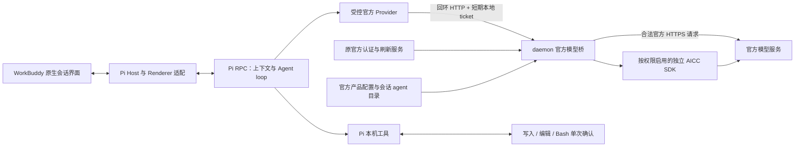

# WorkBuddy 5.9.1 Pi 官方模型桥：0.2.2 技术说明

截至 2026-10-24，官方模型桥、Pi 多模型 Provider、官方认证刷新复用和 AICC 协议适配已实现。**0.2.2 已在原生界面使用 `hy4-preview-ioa` 完成对话、write 单次审批、停止上游、新任务及完整退出后的登录／模型／Pi 上下文恢复。** 0.2.0 的模型重启回退已修正，0.2.1 未启动且在预检撤下，不作为交付。

当前实现覆盖官方会话目录和已识别的 Chat Completions、Responses、AICC 传输分支。这不代表目录内 32 个模型已经逐个在线调用，也不代表 AICC 已通过远端 TEE 验收。

## 版本与应用边界

| 版本 | 模型路径 | 验证状态 |
| --- | --- | --- |
| 0.1.1 | Pi 直连 Ollama／自定义端点，官方登录独立保留 | 历史本机验收结果，不作为官方模型验收依据 |
| 0.2.0 | Pi → 本机官方模型桥 → 官方服务 | `hy4-preview-ioa` 已实测；当时仍暴露原始产品目录，默认 Hy4、启动选型恢复及终态后的连接清理计数存在问题 |
| 0.2.1 | 修正原会话目录、Hy4 别名和流终态计数的中间候选 | 未启动；预检发现暂时缺失的目录仍可能丢失模型偏好，已撤下，不作为交付版本 |
| 0.2.2 | 在上述修正上独立保存 requestedModelId，并增加 5 秒本机目录刷新 | 构建、签名、回归及原生 Hy4 对话／审批／停止／新任务／退出恢复通过；封装同一副本 |

该路线制作独立的 `WorkBuddy Pi.app` 候选副本，内置 Pi 1.1.0 和 Node 24.21.0，移除副本中的 CodeBuddy CLI、预热池及旧 agent-harness 执行入口。已经安装的 `/Applications/WorkBuddy.app`、历史 DMG 和 0.2.0 候选不被这次源码更新改写。原版 ASAR／主程序哈希未变，原版 strict 签名已在非沙箱环境复核通过；候选副本采用独立重签，二者不可混称。

新包配置已移除 Ollama 地址、模型和依赖，使用官方登录与官方模型，不恢复 CodeBuddy CLI 作为推理或任务执行器。原来的私有 `auth-gateway` 及“不修改原安装包”的外置接入实验属于另一条方案，不在这条模型调用链中。独立副本的构建、签名和迁移说明见 [package-dmg/README.md](../pi-harness/package-dmg/README.md)。

## 实际调用链



Pi 负责工具选择、执行、上下文、续轮和最终完成判定；官方服务返回推理结果及工具调用。写入、编辑和 Bash 每次都经过 Host 审批，没有永久允许选项；read、grep、find、ls 为配置允许的只读工具。普通扩展发现、MCP、技能和项目上下文发现保持关闭，审批和官方 Provider 仅通过明确路径及完整性校验装载。

| 实现文件 | 职责 |
| --- | --- |
| [patches.mjs](../pi-harness/package-dmg/patches.mjs) | 在独立候选 daemon core 挂载桥，注入原有认证、产品配置和 HTTP 服务 |
| [official-model-bridge.cjs](../pi-harness/src/official-model-bridge.cjs) | 本机授权、官方目录过滤、目标／请求头、官方刷新、流转发和终态诊断 |
| [Provider 入口](../pi-harness/src/official-provider-extension.ts) / [工厂模块](../pi-harness/src/official-provider-extension.mjs) | 注册 `workbuddy-official`，按每个模型的 API 选择 Pi 标准流式实现 |
| [official-bridge.mjs](../pi-harness/src/official-bridge.mjs) | 私有 locator 校验、目录加载、本地 ticket 轮换和仅回环请求 |
| [pi-harness.mjs](../pi-harness/src/pi-harness.mjs) | 多模型、Hy4 别名与偏好、每线程 RPC、审批、Reasoning／Usage 和恢复 |
| [official-aicc.cjs](../pi-harness/src/official-aicc.cjs) | AICC 控制面、请求保护、响应解密及明文／截断拒绝 |
| [bootstrap.cjs](../pi-harness/package-dmg/bootstrap.cjs) | 独立目录、官方配置、旧配置私有备份和候选入口 |

Provider 的 `.ts` 静态入口是已验证的装载要求：Pi 的 jiti loader 将静态 API 导入解析到内置 PiEngine。早期 `.mjs` 动态包导入没有经过别名解析，实际启动失败，现实现已替换；不依赖用户另装 Pi 或设置模块路径。

## 官方认证与本机 ticket

权威 `authenticationManager`、`ProductManager`、`restOperations` 位于原 daemon，模型桥直接复用它们。Electron main 的账号投影或 `auth:getToken` 不承担完整官方刷新生命周期。

每次官方模型请求先等待 `waitForSessionRefresh()`，再由原 `restOperations` 认证拦截器使用当前官方会话。上游在输出前返回 401 时，桥调用 `refreshSessionForAuthenticationFailure()`，在账号身份仍一致且请求未取消的前提下重试一次；失败转为重新登录提示。已开始输出的流不通过这条分支盲目重放。

桥按用户、账号类型、企业和认证 domain 绑定身份。登出或身份变化撤销本地授权、取消活动请求并关闭 AICC 上下文。普通 access token 刷新仍由官方认证服务管理，不把新 token 复制给 Pi。

Pi 只读取 `pi/bridge/locator.json` 中的回环端口、进程／实例标识、到期时间和短期本地 ticket。目录为 0700、locator 为 0600，读取端检查普通文件、同属主、权限和有效期。ticket 默认 5 分钟，由 daemon 轮换；Pi 每次请求重读，本地 401 且 locator 确实变化时只重试一次。ticket 不是官方 Bearer，也不增加账号或模型权益。

桥只监听 `127.0.0.1`，验证本机 Host，拒绝浏览器 Origin，并要求 ticket。上游只允许可信官方 HTTPS 域和目标，禁止自定义／本地模型回退及重定向。安全目录不含模型 URL、官方 token、API key 或账号信息。

| 本机接口 | 用途 |
| --- | --- |
| `GET /v1/models` | 授权后的官方会话模型、安全元数据和过滤统计 |
| `POST /v1/chat/completions` | 普通 Chat Completions 或桥端解密后的 AICC 路径 |
| `POST /v1/responses` | 官方 Responses 路径 |
| `GET /v1/status` | 受 ticket 保护的就绪／认证状态、目录与请求计数，不返回官方凭据 |

线程和轮次通过单独的 0600 `*.request.json` 关联，文件只存 Host thread ID／turn ID，不存 prompt 或 token。Provider 传给本地桥，再映射为官方 `X-Conversation-ID`／`X-Conversation-Request-ID`；消息 ID、请求 ID、客户端和隐私优化标志由桥及原服务补充。

## 官方目录、Hy4 与启动恢复

0.2.2 沿用原会话 agent 的范围和顺序，不把全部产品模型放进任务菜单。规则为默认 agent、其次 `cli`、再其次含模型的 agent；按其 ID／名称解析和原 chat 回退后，再执行内置模型及可信目标过滤。

本次原版 5.9.1 的脱敏投影有 **100 条产品模型记录，原 CLI 会话可选模型为 32 个 ID**。当前 fixture 按原顺序得到这 32 个，排除了辅助图像／视频／补全模型、未选开发变体、本地／自定义模型和不可信目标。32 是当前配置快照，不是其他账号或未来目录的固定承诺。

同名模型不按展示名合并：只有原版同时可选的不同 ID 才分别保留，并附 ID 描述。当前范围含 `hy4-preview-ioa`，不含同名 `hy4-preview-dev`。`disabled/disabledReason` 保留用于展示，Pi 可用目录、选择和启动都拒绝失权条目。

默认配置 `hy4` 是明确别名：优先可用的精确 `hy4`，否则选目录中首个可用、匹配 `^hy4(?:[-_.]|$)` 的 ID，当前解析为 `hy4-preview-ioa`。线程、Pi `set_model` 和 `turn.model` 使用真实 ID。没有可用 Hy4 时，`currentModelId` 为 null，发送前报 `OFFICIAL_MODEL_SELECTION_REQUIRED`，不自动改为 Auto。

0.2.2 将模型偏好与暂时可用状态分别持久化：`requestedModelId` 保留用户选择／默认别名，`currentModelId` 表示当前目录中可用的真实 ID。启动先取得静态目录、稍后远端 overlay 才到达时，临时缺失或禁用只清 current，不删除 requested；目录恢复后重新解析原偏好。别名一旦解析成功，偏好收敛为真实 ID。用户明确选择其他合法模型会更新偏好，后续刷新不会抢回 Hy4。

Host 有 5 秒、unref 的本机目录刷新，复用已有请求合并和缓存；失败安静，不发模型请求、不影响停止，关闭时清理计时器。恢复选择不需要手动刷新或发送 prompt。旧格式只有 current 时沿用它；旧格式 current 已为 null 且没有偏好时，只重试配置默认别名，不从历史轮次猜选型。

若旧 0.2.0 已把合法的 `fast-model` 落盘，旧格式不能区分它来自早期回退还是用户主动选择，升级保留这个有效 ID。此类历史状态需明确选择一次 Hy4，再验证后续重启恢复；新线程直接按 Hy4 别名解析。这是迁移边界，不以改写历史猜测用户意图。

`/v1/models.metadata` 和 `/v1/status.catalogMetadata` 报告产品数、会话数、暴露／可用数、所选 agent 及排除 ID／原因。它们用于解释过滤，不替代官方请求时的真实权益检查。

## 协议、工具、Usage 与停止

普通模型按各自描述选择 Chat Completions 或 Responses。桥保留明确的完整特殊 URL，合并 `providerData/extra_vars`，保留工具 schema、增量参数、调用 ID、结果和能力限制；不把全部模型强行指向同一地址。不支持工具的模型在 Provider 中移除工具声明，AICC 走独立保护分支。

Pi prompt 的成功响应仅表示接受请求。Host 消费正文、工具和 Reasoning，并等 `agent_settled` 才判定整轮完成；Provider 响应结束或 `agent_end` 不代表工具续轮已结束。当前启动参数为 `--thinking off`，同时保留实际返回的 thinking 和 reasoning 计量，不由该参数推导所有官方模型都能关闭思考。

Usage 使用 Pi 归一化的真实响应字段：`input` 不含缓存，原生 UI 输入总量为 `input + cacheRead + cacheWrite`；reasoning 是 output 子集，不能再次相加。0.2.0 文本实测 input=2227、output=87、totalTokens=2314，其中 reasoning=77；工具轮次还报告了真实缓存读取。

Host 标记 `costKnown: false`，不展示虚构价格、积分或扣费。上游未报告计量时 Pi 可能保留默认零计数，这不证明请求零 token 或零费用。响应模型显示真实 `turn.model`，不用 Harness 名称冒充。

当前桥包含终态感知 SSE 监测：`[DONE]` 或 Responses 完成／不完整终态后，消费者结束读取引发的物理连接清理记为完成，并单列 `upstreamClosedAfterTerminal`；终态前用户停止才计取消和 `upstreamAborted`。Responses 失败事件计错误，无协议终态的 EOF 计断流，不把部分正文伪装为完成。0.2.0 的旧计数可能将正常终态后的清理归入取消，不能据此反推停止次数。

用户停止沿 RPC abort → Provider AbortSignal → 本地桥 → 原 HTTP 请求传递，关闭实际上游。取消撤销未完成审批，旧进程关闭后才允许下一轮，避免迟到事件串线。诊断分别显示 `activeRequests/completed/cancelled/errors/upstreamAborted/upstreamClosedAfterTerminal`。

错误仅从桥构造的已知 code 或明确 HTTP 状态归类，输出固定中文和安全 code，不转发原始 `errorMessage`、凭据或请求体：

| 情况 | Host 分类 |
| --- | --- |
| 401／官方会话失效 | `OFFICIAL_AUTH_REQUIRED`，提示重新连接或登录 |
| 403／模型或 AICC 权限不足 | `OFFICIAL_MODEL_FORBIDDEN`，提示检查权益或换模型 |
| 429 | `OFFICIAL_RATE_LIMITED`，提示额度或频率限制，不擅自判断扣费或额度归零 |
| 默认／先前模型不可用 | `OFFICIAL_MODEL_SELECTION_REQUIRED`，等待合法选型或目录恢复 |
| 已知输入／API 不兼容 | `OFFICIAL_REQUEST_INVALID` |
| 已知流或 AICC 校验失败 | 固定传输错误；未知错误保留通用安全提示，不伪造完成 |

## AICC 独立 SDK 与门控

候选单独保留原 WorkBuddy 5.9.1 的 `@tencent/tcaicc` 1.4.0 协议／加密 SDK 块，114,429 字节，SHA-256 为 `c62e93beba2a2fc16aadfd8120d920883ec79bdd54f72a715c5bdfd1bf959dee`。来源为原 ASAR 成员 `cli/dist/lazy-lite-wb/6951.67f39af7.mjs`，记录见 [provenance.json](../pi-harness/src/official-aicc-sdk.provenance.json)。这不恢复 CodeBuddy CLI、agent loop 或完整执行器。

AICC 同时受产品功能开关、允许模型清单、`enterprise:aicc` 标签和环境／账号条件门控；当前要求 IOA 环境或 `ultimate` 账号。条件不满足时保留禁用原因并拒绝推理，不降级明文，也不换模型冒充。

获准请求由独立 SDK 创建上下文、保护请求、处理控制面、解密普通／SSE 响应并关闭上下文。控制面同样复用权威认证与刷新。受保护字段未发生预期变换、出现明文或严格流被截断时失败。SDK 加载显式设置 `setAiccDebug(false)`、`setAiccVerify(false)` 并屏蔽 vendor 日志；这些配置及本地测试不构成远端证明成功证据。

Fixture 已验证实际 SDK 加载、加密／篡改拒绝、受保护流转换、明文拒绝、截断和门控。**没有完成真实 AICC 服务、远端证明或 TEE 验收**，不由 fixture 推导生产保密性或服务端可用性。独立 SDK 再分发许可仍以来源记录为准，候选为内部验证包。

## 配置与迁移

独立数据根目录为 `~/Library/Application Support/WorkBuddy-Pi-5.9.1/`，使用独立官方账号缓存，不导入原版缓存，也不删除已有独立候选账号与历史。

```json
{
  "officialOnly": true,
  "officialBridgeDir": "<独立数据目录>/pi/bridge",
  "provider": "workbuddy-official",
  "model": "hy4"
}
```

可执行文件与完整路径由 bootstrap 按应用当前位置生成。官方模式拒绝其他 Provider；`pi/agent/models.json` 为 `{ "providers": {} }`，受控 Provider 动态取目录，不在配置中写官方 token、静态 ticket 或 Ollama 地址。

改写 `pi-config.json`、`models.json`、`settings.json` 前，bootstrap 按原始字节备份到 `pi/migration-backups/official-model-0.2.2-*`，目录 0700、文件 0600。工作区、账号、Host 线程和真实 Pi session 保留。旧 Ollama 历史只切换后续选型，不自动重放 prompt，也不凭旧记录恢复外部调用。

退出重启读取偏好和 Pi session，上次未完成轮次标记 interrupted，审批标记取消；历史恢复本身不发模型请求。源码对旧外部实验模式保留兼容入口，不代表新官方包启用了该模式。已有旧格式的无效 `fast-model` 偏好会要求明确选择；本机选定 Hy4 后，退出重启已验证自动恢复真实 ID。

## 验证结果与覆盖

| 项目 | 结果与边界 |
| --- | --- |
| 0.2.0 官方 Hy4 文本 | 实际 `hy4-preview-ioa` 返回 `HY4-BRIDGE-OK`，报告真实 Usage |
| 0.2.0 write 审批 | 单次允许后实际写入成功，由 Pi 执行 |
| 0.2.0 停止 | 实际停止上游、活动请求归零；不以旧累计取消计数推导停止次数 |
| 实际 Pi + Fake 回环桥 | Provider 装载、目录、切模型、SSE、Usage 和取消通过，没有外部模型调用 |
| 0.2.1 候选 | 未启动，预检撤下，不作为实机通过或交付记录 |
| 0.2.2 目录与终态 | 100→32、安全同名变体、正常终态清理、Responses、断流及 AICC 定向测试通过 |
| 0.2.2 模型与恢复 | Hy4 别名、真实 ID 持久化、静态目录→overlay 自动恢复、禁用后恢复、显式改选、旧 null 状态和不重放请求测试通过 |
| 0.2.2 构建与回归 | stage、strict 签名、22 项源码／manifest 匹配（其中 16 项运行时）；整套 323 项：322 通过、1 项 opt-in 跳过；候选真实 Pi + 本机 Fake 桥另跑 1/1 通过 |
| 0.2.2 官方 Hy4 文本／工具 | 实际返回 `HY4-022-OK`，输入 2225、输出 47、总计 2272 token；write 批准前文件不存在，单次允许后写入固定内容并完成续轮 |
| 0.2.2 停止 | 活动请求 1→0，取消／上游中断各增 1，错误为 0；原生界面显示已取消 |
| 0.2.2 退出恢复／新任务 | 正常退出清理进程、locator、Host lock；再开自动恢复官方登录、原线程和真实 Hy4 ID；不调用工具正确回忆写入内容；新任务默认 Hy4 成功响应 |
| 0.2.2 DMG | 同一副本封装，hdiutil 与只读挂载验签／源码／ASAR／Fuse／CLI 移除复核通过，已卸载；尺寸及 SHA-256 见安装包说明 |
| 官方过期刷新 | 使用真实 daemon 刷新方法并有模拟 401 回归；本次未人为令官方令牌过期，不宣称实际过期场景已经验收 |
| 其他模型与 AICC | 目录和协议分支已接，未逐个在线验证；真实 AICC／远端 TEE 未验收 |

主要证据：

- `evidence/pi-official-implementation/acceptance/live-020.json`：0.2.0 官方轮次安全投影；旧 modelCount=100 和取消计数是修正前语义。
- `evidence/pi-official-implementation/acceptance/live-022-*.json`：最终候选目录、Usage、审批前后、取消前后、退出清理、重启及新任务结果；公开交付版归纳在 `dist/WorkBuddy-Pi-5.9.1-test-0.2.2/验收记录.json`。
- `evidence/pi-official-implementation/acceptance/model-selection-metadata.json`：原版 agent／模型投影，不含 URL、Key 或账号。
- `evidence/pi-official-implementation/daemon/changes-0.2.1.md`、`validation-0.2.1.json`：会话目录、终态修正结果与哈希。
- [official-model-bridge.test.mjs](../pi-harness/test/official-model-bridge.test.mjs)、[official-provider-cli.test.mjs](../pi-harness/test/official-provider-cli.test.mjs)、[pi-harness.test.mjs](../pi-harness/test/pi-harness.test.mjs)：桥、真实 Pi 装载、偏好恢复及 Host 契约的可重复测试。

最初 REA 核对保留在 `evidence/pi-official-models-20261024/`，包含目录、daemon 认证边界、CLI 推理和 Pi 扩展接口的出处与哈希。原版 5.9.1 ASAR SHA-256 为 `1fc0a56ddec5437d4dc55a55ba1c028b291ab29cb17306500827015987424233`。静态记录说明实施依据；实机是否通过以分版本结果为准，不以目录可见、HTTP 200、单模型通过或签名校验替代完整验收。
